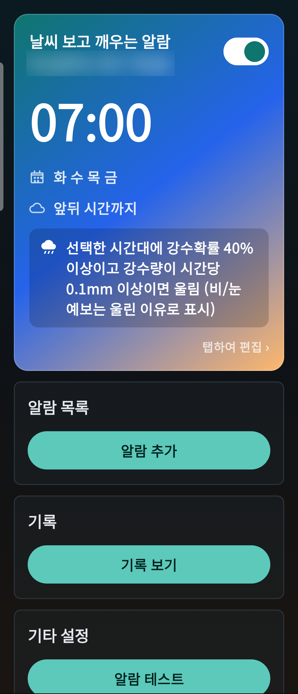
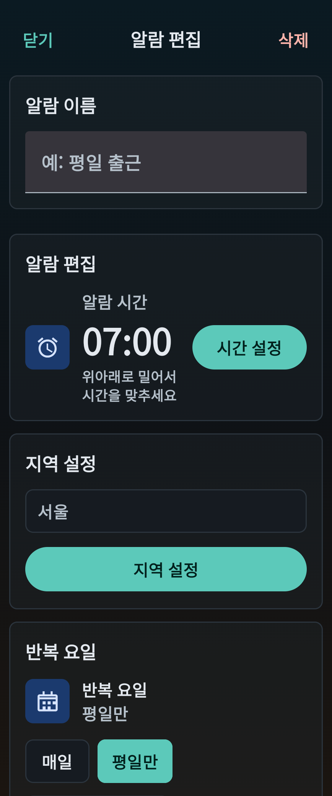
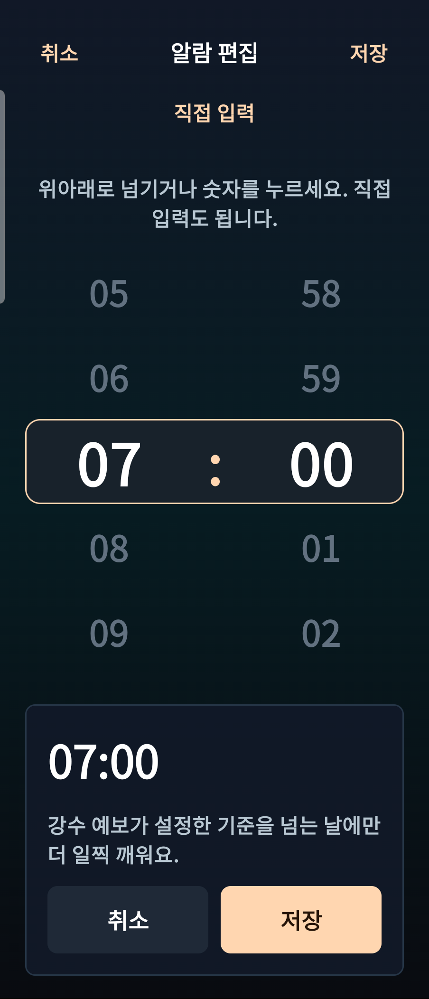
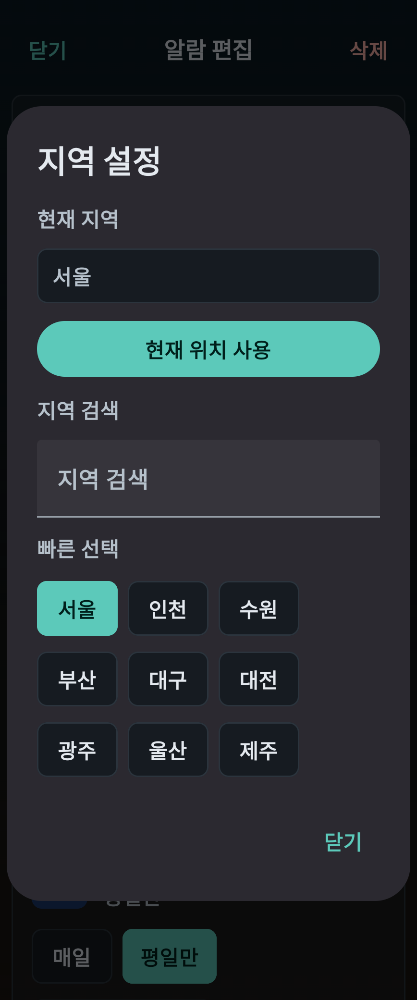
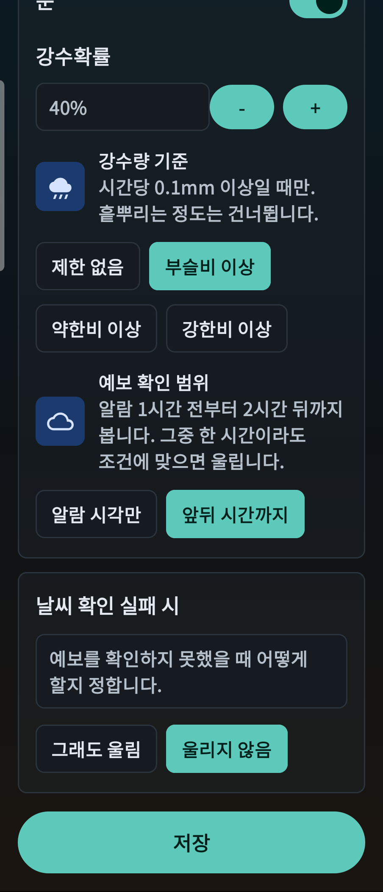
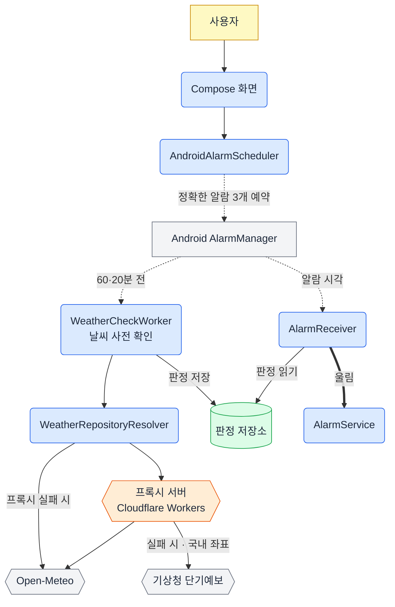
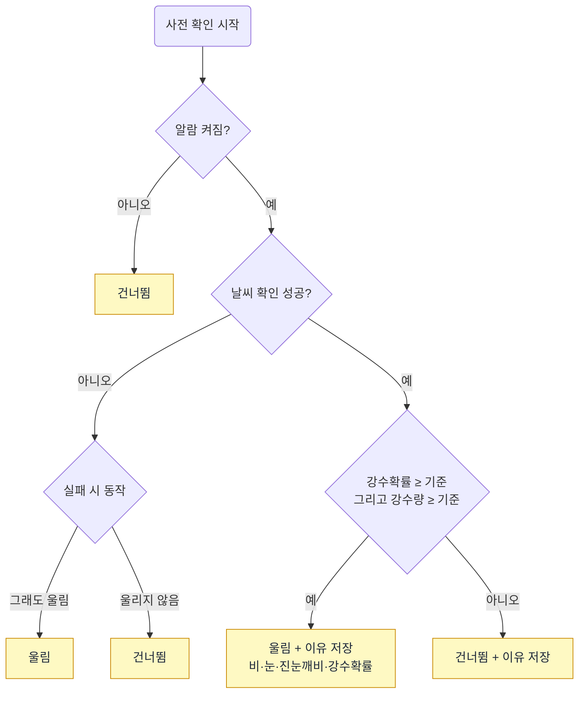
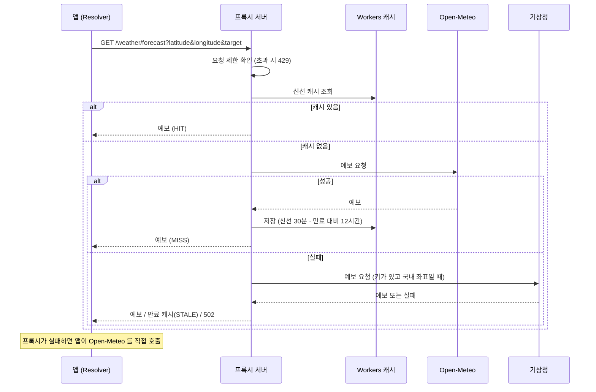

# Weather Morning Alarm

아침 날씨가 정한 조건을 만족할 때만 울리는 Android 조건부 알람 앱입니다.
An Android alarm that rings only when the morning forecast meets your conditions.

| 상태 | 형태 | 개발 방식 | 라이선스 |
|---|---|---|---|
| 개인 사용 중 · 스토어 미출시 | Android 앱 + 프록시 서버 | 기획 직접 · 코드 AI 작성 | MIT |

비 오는 날에는 일찍 일어나 출근 준비를 하고, 맑은 날에는 평소대로 자고 싶어서 만들었습니다. 몇 달째 실제로 쓰고 있습니다.

## 화면

<table>
  <tr>
    <td align="center"><br><sub>알람 목록</sub></td>
    <td align="center"><br><sub>알람 편집</sub></td>
    <td align="center"><br><sub>시간 선택</sub></td>
  </tr>
  <tr>
    <td align="center"><br><sub>지역 설정</sub></td>
    <td align="center"><br><sub>날씨 조건 설정</sub></td>
    <td></td>
  </tr>
</table>

## 주요 기능

- **조건부 울림**: 알람 60분 전과 20분 전에 날씨를 미리 확인하고, 조건을 만족할 때만 울립니다.
- **조건 설정**: 강수확률 기준, 강수량 기준(선택 안 함 / 부슬비 / 약한 비 / 강한 비 이상), 확인 범위(알람 시각만 / 앞뒤 시간까지)를 정합니다. 예보가 비·눈·진눈깨비면 울림 이유에 표시합니다.
- **실패 시 동작**: 날씨를 확인하지 못했을 때 그래도 울릴지, 울리지 않을지 고릅니다.
- **반복**: 요일을 반복하고, 한국 공휴일은 건너뛸 수 있습니다.
- **기록**: 울렸거나 건너뛴 이유를 저장하고 최근 기록을 보여 줍니다.
- **알람 신호**: 시스템 벨소리를 고르고, 진동과 스누즈를 씁니다.
- **재부팅 대응**: 기기를 다시 켜면 알람을 다시 예약합니다.

## 구조



날씨는 알람 직전이 아니라 **미리 확인해서 판정을 저장**해 두고, 알람 시각에는 저장된 판정만 읽습니다. 알람 시각에 네트워크가 없어도 판정대로 울리거나 건너뛸 수 있습니다. 자세한 설명: [docs/architecture.md](docs/architecture.md)

## 핵심 흐름

### 울림 판정



알람 시각에는 6시간 안에 저장된 판정만 믿고, 없거나 오래됐으면 '실패 시 동작'을 따릅니다. 자세한 순서: [docs/alarm-flow.md](docs/alarm-flow.md)

### 날씨 요청



엔드포인트 상세: [docs/api.md](docs/api.md)

## 대표 코드

**날씨 조건 판정** — 강수확률과 강수량 기준을 먼저 계산합니다. 두 기준을 모두 만족하면 울리고, 예보 종류(비·눈·진눈깨비)에 따라 울림 이유를 다르게 남깁니다.

```kotlin
val probabilityMatches = weather.precipitationProbability >= settings.precipitationThreshold
val amountMatches = precipitationAmountMatches(settings.rainAmountThreshold, weather)

if (settings.triggerRain && weather.condition == WeatherCondition.RAIN && probabilityMatches && amountMatches) {
    return AlarmDecision(
        shouldRing = true,
        reason = rainReason("Rain forecast", settings, weather),
        decidedAt = Instant.now(),
        weatherSnapshot = weather,
        reasonCode = AlarmReasonCode.RAIN_FORECAST,
    )
}
// ...
```
→ [DecideAlarmUseCase.kt](app/src/main/java/com/weathermorning/alarm/domain/usecase/DecideAlarmUseCase.kt#L48-L59)

**알람 예약** — 사전 확인 두 번(60분·20분 전)과 실제 알람을 각각 정확한 알람으로 예약합니다. 하나가 늦어져도 다른 사전 확인이 판정을 남깁니다.

```kotlin
scheduleExact(
    requestCode = requestCode(settings.id, SLOT_PRECHECK_BACKUP),
    atMillis = alarmAt.minusMinutes(PRECHECK_BACKUP_MINUTES).toEpochMillis(),
    intent = precheckIntent(settings.id),
)
scheduleExact(
    requestCode = requestCode(settings.id, SLOT_PRECHECK),
    atMillis = alarmAt.minusMinutes(PRECHECK_MINUTES).toEpochMillis(),
    intent = precheckIntent(settings.id),
)
scheduleExact(
    requestCode = requestCode(settings.id, SLOT_ALARM),
    atMillis = alarmAt.toEpochMillis(),
    intent = alarmIntent(settings.id),
)
```
→ [AndroidAlarmScheduler.kt](app/src/main/java/com/weathermorning/alarm/alarm/AndroidAlarmScheduler.kt#L47-L61)

**프록시 캐시** — 신선 캐시가 있으면 바로 돌려줍니다. 없으면 Open-Meteo, 기상청 순서로 요청하고, 모든 예보 제공자가 실패하면 만료 대비 캐시로 응답합니다.

```javascript
const cached = await cache.match(freshCacheRequest);
if (cached) {
  logInfo("forecast_cache_hit", { cache: "HIT" });
  return withCacheHeader(cached, "HIT");
}
// ...
const stale = await cache.match(staleCacheRequest);
if (stale) {
  logInfo("forecast_cache_hit", { cache: "STALE" });
  return withCacheHeader(stale, "STALE");
}
```
→ [index.js](backend/weather-proxy/src/index.js#L58-L105)

## 기술

| 영역 | 기술 |
|---|---|
| 앱 | Kotlin, Jetpack Compose (Material 3), minSdk 26 · targetSdk 36 |
| 백그라운드 | AlarmManager(정확한 알람), WorkManager, 포그라운드 서비스 |
| 저장 | Room(알람 기록), 로컬 설정 저장소 |
| 서버 | Cloudflare Workers (JavaScript), Workers Cache, Rate Limiting |
| 외부 API | Open-Meteo, 기상청 단기예보, 한국천문연구원 특일 정보 |

## 검증

| 항목 | 결과 | 비고 |
|---|---|---|
| Android 단위 테스트 | **확인함** 63개 통과 | `gradlew testDebugUnitTest`, 2026-10-14 |
| 서버 테스트 | **확인함** 23개 통과 | `node --test`, 2026-10-14 |
| 디버그 빌드 | **확인함** 성공 | `gradlew assembleDebug`, 2026-10-14 |
| DB 마이그레이션 계측 테스트 | **실행 안 함** | 기기가 필요해 이번 확인에서 제외 |
| Android Lint | **확인함** 오류 0개 · 경고 48개 | `gradlew lintDebug`, 2026-10-14 |
| 실기기 업데이트 | **확인함** 0.3.3 → 0.3.4 → 0.3.5 데이터 유지 | 같은 서명으로 덮어쓰기 설치, 예약된 알람 3개 유지, 2026-10-14 |
| 실기기 알람 울림 | **기록만 있음** | 작업 기록 문서에 있음, 이번에 재확인하지 않음 |

## 한계

- 판정은 예보를 기준으로 하므로 실제 날씨와 다를 수 있습니다.
- 제조사 절전 정책에 따라 사전 확인이 늦어질 수 있습니다 (사전 확인을 두 번 예약해 완화).
- 앱 화면에는 날씨 데이터 출처 표시가 아직 없습니다.
- 스토어에 출시하지 않았습니다 (서명된 APK 로 설치).

## 개발 방식

기획과 진행은 직접 했고, 코드는 AI 코딩 도구(Codex)가 작성했습니다.

## 실행 방법

```powershell
# Android (JDK 17, Android SDK 필요)
.\gradlew.bat assembleDebug
.\gradlew.bat testDebugUnitTest

# 프록시 서버 주소를 넣어 빌드할 때
.\gradlew.bat assembleRelease -PweatherProxyBaseUrl=https://<your-worker>.workers.dev

# 서버 테스트
cd backend\weather-proxy
node --test
```

릴리스 서명은 `keystore.properties.example` 을 `keystore.properties` 로 복사해 값을 채웁니다 (저장소에 올리지 않음). 서버 비밀값(기상청 키 등)은 Cloudflare secret 으로 관리합니다 (`backend/weather-proxy/.dev.vars.example` 참고).

## 문서

- [docs/architecture.md](docs/architecture.md) — 구성 요소와 책임
- [docs/alarm-flow.md](docs/alarm-flow.md) — 예약부터 울림까지
- [docs/api.md](docs/api.md) — 프록시 엔드포인트
- [docs/technical-decisions.md](docs/technical-decisions.md) — 설계 결정과 이유
- [docs/DEVELOPMENT.md](docs/DEVELOPMENT.md) — 개발·릴리스 명령 모음

## 데이터 출처와 라이선스

- 날씨 예보: [Open-Meteo](https://open-meteo.com/) (CC BY 4.0), 기상청 단기예보 (공공데이터)
- 공휴일: 한국천문연구원 특일 정보 (공공데이터)
- MIT License — [LICENSE](LICENSE). 폰트(Noto Sans CJK, OFL 1.1)와 Material Icons(Apache 2.0) 등은 각자의 라이선스를 따릅니다 — [THIRD_PARTY_NOTICES.md](THIRD_PARTY_NOTICES.md)
