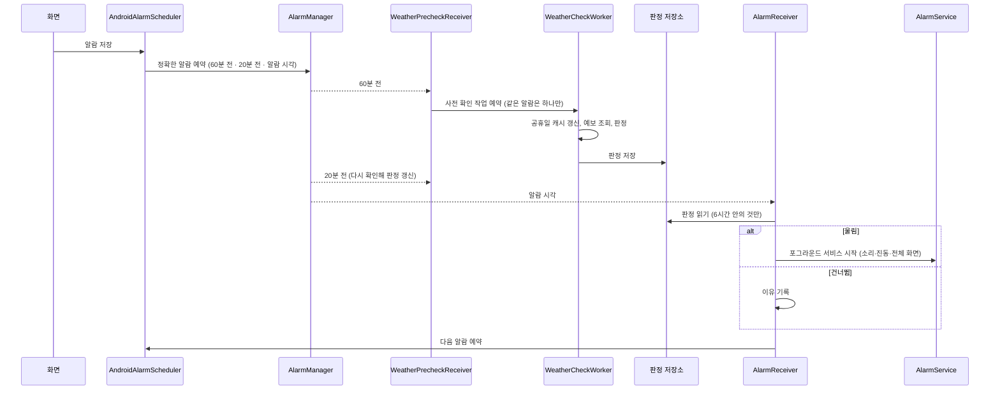

# 알람 흐름

예약 → 사전 확인 → 알람 시각 처리 → 울림 순서입니다.

## 단계별 설명

1. **예약** (`AndroidAlarmScheduler.scheduleNext`): 다음 알람 시각을 요일·공휴일 설정으로 계산하고, `setExactAndAllowWhileIdle` 로 세 개의 정확한 알람을 겁니다. 판정에 영향을 주는 설정이 바뀌지 않았으면 이미 저장된 판정을 지우지 않습니다.
2. **사전 확인** (`WeatherCheckWorker.doWork`): 확인 범위가 '알람 시각만'이면 한 시각, '앞뒤 시간까지'면 여러 시각의 예보를 조회해 판정합니다. 판정은 먼저 저장하고, 모든 제공자가 실패했으면 정해진 횟수 안에서 재시도합니다.
3. **알람 시각** (`AlarmReceiver.onReceive`): 저장된 판정이 6시간 안의 것이면 그대로 따르고, 없거나 오래됐으면 '실패 시 동작'(울림/건너뜀)을 따릅니다. 테스트 알람과 스누즈는 판정 없이 울립니다.
4. **울림** (`AlarmService`): 포그라운드 서비스가 소리와 진동을 내고 알림을 띄웁니다. 전체 화면 알람이 뜨지 못하는 상황에서도 서비스가 계속 울립니다.

## 판정 규칙 (`DecideAlarmUseCase`)

| 순서 | 조건 | 결과 |
|---|---|---|
| 1 | 알람 꺼짐 | 건너뜀 |
| 2 | 날씨 확인 실패 | 실패 시 동작에 따라 울림 / 건너뜀 |
| 3 | 비 조건 켜짐 + 비 예보 + 강수확률·강수량 기준 충족 | 울림 (이유: 비) |
| 4 | 눈 조건 켜짐 + 눈 예보 + 기준 충족 | 울림 (이유: 눈) |
| 5 | 비 또는 눈 조건 켜짐 + 진눈깨비 + 기준 충족 | 울림 (이유: 진눈깨비) |
| 6 | 강수확률·강수량 기준 충족 | 울림 (이유: 강수확률) |
| 7 | 그 외 | 건너뜀 |

3~6 은 모두 '강수확률·강수량 기준 충족'을 요구하므로, **울릴지 여부는 두 기준으로만 정해지고** 비·눈 선택과 예보 종류는 울림 이유에만 영향을 줍니다. 0.3.5 부터 홈 화면 요약과 시간 선택 화면 문구도 이 판정(강수확률과 강수량 기준을 모두 충족)과 같은 내용으로 표시합니다.

강수량 기준은 선택 안 함(0), 부슬비 0.1, 약한 비 2.0, 강한 비 10.0 mm/h 입니다.
